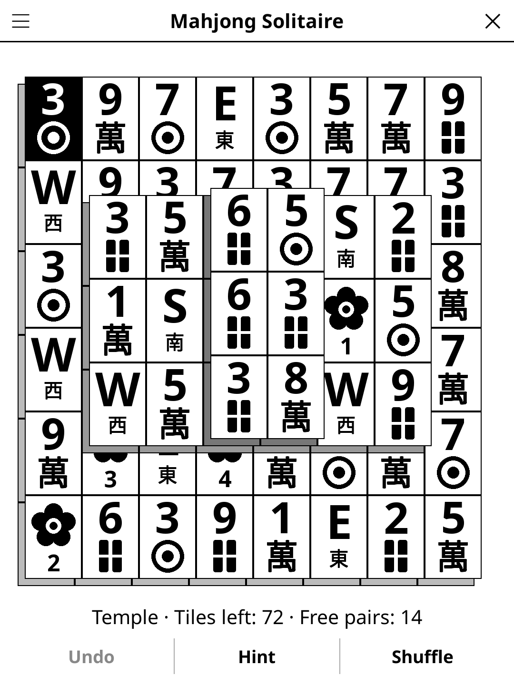

# mahjong.koplugin

**Mahjong Solitaire** (FR « Mahjong solitaire ») — the classic tile-matching
solitaire for [KOReader](https://github.com/koreader/koreader): take the
tiles off the table two by two, in matching pairs, until it is empty.

## Screenshot

## Rules

1. Only **free** tiles can be taken: nothing lies on the tile, even partly,
   and no tile touches it on at least one of its left and right sides.
2. Two tiles match when they are identical; any flower matches any flower,
   any season any season.
3. The game is won when the table is empty.

## Features

- **Six layouts** — Pyramid (56 tiles), Fortress (72), Temple (72, the
  default: big tiles on a 6" portrait screen), Bridge (88), Big pyramid (120)
  and the traditional Turtle (144). In landscape the board goes beside or
  under the buttons, whichever gives bigger tiles.
- **Every deal can be won** — deals are built backwards from an empty table
  (pairs of free tiles taken off a full layout, then given matching faces),
  so at least one way to clear the table always exists.
- **Checked hints** — two taps: the first marks a pair, the second takes it
  off. The pair keeps the game winnable from where you are; if the on-device
  search runs out of time (rare, big layouts), the hint says so honestly. When
  the game can no longer be won, the hint tells you to Undo or Shuffle.
- **Shuffle** — deals the faces of the tiles left again, in an arrangement
  that can be cleared.
- **Undo** (pairs and shuffles), tiles-left and free-pairs counters, timer,
  auto-save.
- **Statistics** per layout (games won / played, best time) and a **Daily
  Challenge** (the same deal for everyone today, per layout).
- **Two tile styles** — *Readable* (big numbers with a suit sign, wind
  letters in your language, boxed dragons) and *Traditional* (dot and bamboo
  patterns, Chinese numerals, 東南西北, 中 發). **Mark free tiles** greys the
  tiles you cannot take yet.

## Controls

| Action | How |
|--------|-----|
| Select a tile | Tap a free tile (it turns black); tap it again to let go |
| Take a pair | Tap a matching free tile |
| Undo / Hint / Shuffle | Buttons under the board |
| New game, Daily Challenge, layout, tile style, free-tile marking, statistics, rules | Title-bar menu |

## Why e-ink friendly?

Black, white and a few greys, drawn for a 6" 758×1024 screen: each tile
shows its side on the left and below, every layer sits up and to the right of
the one under it and the higher a tile, the darker its side, so stacks read
without colour. The selected tile is inverted, the hinted pair gets a thick
dashed outline. No animation: a move repaints once.

Chinese characters use Noto Sans CJK, the fallback font KOReader ships on
every device.

## How it works

`deal.lua` deals (reverse construction) and solves: a depth-first search
that takes off whole groups of free tiles without branching, prunes
positions where a tile's remaining partners all lie on it, remembers lost
positions and restarts with growing budgets. On the reader a hint search is
capped at 20 000 nodes / 1.5 s. The board keeps a known solution (from the
deal, a shuffle or the last search) and follows it as long as you do, so most
hints cost nothing. `tools/bench.lua` (not shipped) checks the dealer and the
solver on many deals.

## License

GPL-3.0
